# Nudge — Engineering Handoff Document

> **Last updated:** 2026-10-13
> **Status:** Active development · Auth temporarily toggle-able · IR retrieval system live

---

## 1. What is Nudge?

Nudge is a **cross-platform study assistant** (iOS, Android, Web via Expo/React Native) that:

- Accepts PDF, slides, docs, and pasted text from the user
- Runs them through an AI parsing pipeline (Supabase Edge Functions + Gemini) to produce **summaries, detailed notes, flashcards, and quizzes**
- Schedules those flashcards using a **FSRS-style spaced repetition** algorithm
- Provides an academic **Information Retrieval (IR) engine** for searching across all uploaded material using multiple retrieval models
- Tracks study sessions, recall curves, topic mastery, and streaks via an analytics system
- Supports **exam countdown mode** that re-weights the study queue when a deadline is within 7 days

---

## 2. Technology Stack

| Layer | Technology |
|---|---|
| Framework | Expo SDK 55 + React Native 0.83 |
| Routing | Expo Router v55 (file-based) |
| Language | TypeScript 5.9 |
| Backend | Supabase (PostgreSQL + Edge Functions + Storage) |
| AI | Google Gemini (via Supabase Edge Functions) |
| Local DB | expo-sqlite (WAL mode) |
| Async KV | @react-native-async-storage/async-storage |
| Auth | Supabase Auth (email/password) — toggle-able |
| Styling | React Native StyleSheet (no Tailwind) |

---

## 3. Application Architecture

```mermaid
flowchart TD
    subgraph Client["Client · Expo / React Native"]
        direction TB

        subgraph Screens["Screens · src/app/"]
            S1["index.tsx — Dashboard"]
            S2["library.tsx — Upload and Library"]
            S3["assets.tsx — Study Tools Viewer"]
            S4["study.tsx — Focus Session"]
            S5["analytics.tsx — Analytics"]
            S6["reviews.tsx — Flashcard Review"]
            S7["profile.tsx — Profile and Exam Planner"]
            S8["login.tsx — Auth Gate"]
        end

        subgraph IR["IR Engine · src/lib/ir/"]
            IR1["preprocessing.ts — Tokenize, Stop-words, Stemming"]
            IR2["indexing.ts — Inverted Index, Suffix Array"]
            IR3["boolean.ts — Boolean Model + AST Parser"]
            IR4["vsm.ts — TF-IDF Vector Space Model"]
            IR5["pattern-matching.ts — Exact, Prefix, Suffix, Fuzzy, KMP, BM"]
            IR6["relevance-feedback.ts — Rocchio, IDE Regular, IDE DecHi"]
            IR7["evaluation.ts — Precision, Recall, F1, NDCG, MAP"]
            IR8["search.ts — useDocumentSearch hook"]
        end

        subgraph Lib["Core Libraries · src/lib/"]
            L1["spaced-repetition.ts — FSRS-style algorithm"]
            L2["study-analytics.ts — Retention curve, Mastery, Streak"]
            L3["exam-proximity.ts — Exam countdown, Intensity scaling"]
            L4["study-review-loader.ts — Orchestrates state on mount"]
            L5["study-state.ts — SQLite: review cards, sessions, feedback"]
            L6["generated-review-cards.ts — Builds ReviewCards from AI assets"]
        end

        subgraph Parsing["Parsing Pipeline · src/lib/parsing/"]
            P1["pipeline.ts — uploadAndProcessFiles"]
            P2["supabase-api.ts — Edge Function calls"]
            P3["cache.ts — SQLite: sources, assets"]
            P4["document-picker.ts — File selection"]
        end

        subgraph State["Auth and Persistence"]
            A1["constants/auth.ts — AUTH_ENABLED flag"]
            A2["active-user.ts — Global user ID ref"]
            A3["lib/supabase.ts — Supabase client"]
        end
    end

    subgraph Backend["Backend · Supabase"]
        direction TB
        DB[("PostgreSQL — sources, chunks, assets — RLS per user")]
        ST["Storage — Original files"]
        EF1["create-upload — Edge Function"]
        EF2["process-source — Edge Function with Gemini"]
        EF3["get-source-assets — Edge Function"]
        EF4["delete-source — Edge Function"]
        EF5["ask-source — Edge Function with RAG"]
        EF6["verify-citations — Edge Function"]
        HNSW["HNSW Index — halfvec cosine"]
        BM25["GIN Index — BM25 tsvector"]
        RRF["match_chunks RPC — RRF hybrid retrieval"]
    end

    P2 -->|"REST/Edge"| EF1
    P2 -->|"REST/Edge"| EF2
    P2 -->|"REST/Edge"| EF3
    P2 -->|"REST/Edge"| EF4
    P2 -->|"REST/Edge"| EF5
    P2 -->|"REST/Edge"| EF6
    EF2 --> DB
    EF2 --> ST
    DB --- HNSW
    DB --- BM25
    HNSW --> RRF
    BM25 --> RRF

    S1 --> L4
    S2 --> P1
    S2 --> IR8
    S3 --> P2
    S4 --> L3
    S5 --> L2
    S5 --> IR8
    S6 --> L1
    S7 --> L3

    IR8 --> IR3
    IR8 --> IR4
    IR8 --> IR5
    IR8 --> IR6
    IR3 --> IR2
    IR4 --> IR2
    IR2 --> IR1

    L4 --> P3
    L4 --> L5
    L4 --> L6
    L6 --> L1
    L5 --> IR8
```



---

## 4. Screens and Navigation

Navigation is file-based via Expo Router. The shell `_layout.tsx` wraps all screens in `AppTabs` (bottom tab bar) and enforces the auth guard.

| Route | Screen | Purpose |
|---|---|---|
| `/` | `index.tsx` | **Dashboard** — risk score, due cards, exam countdown, weak topics, milestones |
| `/library` | `library.tsx` | **Library** — upload files/paste text, IR search, source list |
| `/assets` | `assets.tsx` | **Study Tools** — browse summaries/notes/flashcards/quizzes, ask-source RAG |
| `/study` | `study.tsx` | **Focus Session** — Pomodoro-style timer, AI-generated study plan |
| `/reviews` | `reviews.tsx` | **Flashcard Review** — FSRS card review with Again/Hard/Good/Easy grading |
| `/analytics` | `analytics.tsx` | **Analytics** — retention curve, mastery by topic, review load, IR evaluation |
| `/profile` | `profile.tsx` | **Profile** — exam planner, theme toggle, logout |
| `/login` | `login.tsx` | **Login** — email/password auth via Supabase |

---

## 5. Backend — Supabase

### Database Tables

| Table | Key Columns | Notes |
|---|---|---|
| `sources` | id, user_id, title, subject, topic, mime_type, storage_path, size, status, stage, progress, outline | One row per uploaded file. Status flow: queued, uploading, processing, ready / failed / needs_ocr |
| `chunks` | id, source_id, chunk_index, text, embedding halfvec 3072, tsv, section_path, page | Text chunks with Gemini embeddings + tsvector for BM25 |
| `assets` | id, source_id, title, type, content_json | Generated study pack with summary, notes, flashcards, quiz, weak_topics |

### Edge Functions

| Function | Trigger | What it does |
|---|---|---|
| `create-upload` | File selected | Creates `sources` row + Storage presigned URL |
| `process-source` | After upload | Chunks text, embeds with Gemini, generates study pack |
| `get-source-assets` | On demand | Returns processed assets for a source |
| `delete-source` | User action | Deletes source + chunks + assets from DB and Storage |
| `ask-source` | Chat in Assets screen | RAG: embeds question, calls match_chunks RPC, Gemini answer |
| `verify-citations` | On demand | Cross-checks generated content against original chunks |

### Hybrid Retrieval (Server-side)

The `match_chunks` PostgreSQL function (migration `20260826000000_retrieval_foundation.sql`) implements **Reciprocal Rank Fusion (RRF)**:

1. **Vector candidates** — HNSW cosine distance on halfvec(3072) Gemini embeddings
2. **Lexical candidates** — GIN/tsvector BM25-style ts_rank_cd ranking
3. **Fusion** — `1/(60 + rank)` RRF scores are summed, top-K returned

This is used by `ask-source` for grounded RAG answers.

### Row-Level Security

Migration `20260827000000_user_isolation_rls.sql` enforces per-user data isolation:
- `sources.user_id` must match `auth.uid()` for all SELECT/INSERT/UPDATE/DELETE
- Chunks and assets inherit isolation through their `source_id` FK

---

## 6. Client-Side IR Engine

Located entirely in `src/lib/ir/`. This is a full academic IR implementation running **100% on-device** — no server calls.

### Modules

| File | Responsibility |
|---|---|
| `preprocessing.ts` | Tokenization, English stop-word removal, Porter-style stemming, noun-group identification |
| `indexing.ts` | InvertedIndexBuilder with term to posting lists, TF + positions, SuffixArray, SuffixTree |
| `boolean.ts` | BooleanModel — recursive-descent AST parser supporting AND/OR/NOT, evaluates against inverted index |
| `vsm.ts` | VectorSpaceModel — TF-IDF with normalized cosine similarity, search returns ranked doc IDs |
| `pattern-matching.ts` | Exact, prefix, suffix, substring, KMP, Boyer-Moore, Levenshtein fuzzy, regex, wildcard, multi-pattern |
| `relevance-feedback.ts` | rocchioAlgorithm, ideRegular, ideDecHi — query vector reformulation |
| `evaluation.ts` | Precision at K, Recall, F1, AP, MAP, NDCG at K, ROC curve data, confusion matrix |
| `search.ts` | **Main entry point** — useDocumentSearch hook + searchDocuments function |

### Search Modes

| Mode | Algorithm | Description |
|---|---|---|
| `hybrid` | All modes fused | Default. Runs all pattern types + VSM with additive scoring |
| `exact` | Substring index scan | Case-insensitive literal match |
| `prefix` | Word-level scan | Matches words starting with query |
| `suffix` | Word-level scan | Matches words ending with query |
| `substring` | Character scan | Any position in text |
| `fuzzy` | Levenshtein distance of 2 | Typo-tolerant matching |
| `boolean` | AST + inverted index | AND/OR/NOT operators |
| `vsm` | TF-IDF cosine | Semantic/conceptual ranking |

### What is Indexed

In `library.tsx`, the `searchDocuments` array built for `useDocumentSearch` indexes **all of the following per source**:
- Source title, subject, topic, inferred file type
- Asset title, summary
- All detailed notes
- Flashcard fronts and backs
- Quiz questions, all choices, and answer
- Weak topic strings

This means search matches against **full document content**, not just titles.

### Retrieval Mode Badges (recently added)

Each `RankedSearchResult` now carries a `retrievedBy: SearchMode[]` array. The Library screen renders color-coded badge pills on each result card so the user can see exactly which retrieval method produced that match:

| Badge | Color |
|---|---|
| EXACT | Blue #1e6fd9 |
| PREFIX | Purple #7c3aed |
| SUFFIX | Cyan #0891b2 |
| SUBSTRING | Teal #0d9488 |
| FUZZY | Amber #d97706 |
| BOOLEAN | Red #dc2626 |
| VSM | Green #16a34a |

### Relevance Feedback (recently redesigned)

**Old behavior:** User had to click "Use Feedback" button after manually marking sources Relevant/Not Relevant from the source list.

**New behavior (implicit feedback):**

1. User types a query and results appear ranked
2. User **clicks a result card** and that document is instantly marked RELEVANT (green border)
3. All other visible result cards are automatically marked **not-relevant** (dimmed)
4. The query is **immediately reformulated** via the active feedback algorithm (Rocchio / IDE Regular / IDE DecHi)
5. New results appear reflecting the reformulated query

Feedback algorithms (toggled via the "Feedback: ..." pill in the mode bar):
- **Rocchio** — q-prime = alpha * q + beta * avg(relevant) - gamma * avg(not-relevant)
- **IDE Regular** — simpler centroid shift without negative doc penalty
- **IDE DecHi** — uses only the highest-scoring not-relevant document

Feedback is persisted to the local SQLite `relevance_feedback` table so it survives app restarts. A "Clear Feedback" button appears when feedback exists.

---

## 7. Spaced Repetition System

Implemented in `src/lib/spaced-repetition.ts`. Uses an **FSRS-inspired** model:

- **ReviewCard** — carries difficulty, stability, lastReviewedAt, dueAt, and full reviewHistory
- **getRetrievability(card)** — `e^(-elapsed / stability)` — probability of recall right now
- **getDueState(card)** — true if now >= dueAt
- **Grading** — four grades: again (1) / hard (2) / good (3) / easy (4)
- After each grade, difficulty and stability are updated; next due date is scheduled
- **interleaveReviewQueue** — shuffles cards by study area to avoid topic clustering
- **dedupeByStudyArea** — picks one card per unique course/topic combination
- **Exam proximity mode** — buildExamProximityQueue in exam-proximity.ts sorts cards by difficulty x low-retrievability when an exam is 7 days or less away

ReviewCard objects are built automatically from AI-generated assets (generated-review-cards.ts) — one card per flashcard in the generated study pack.

---

## 8. Local Persistence Layer

Two SQLite databases are maintained on-device:

### nudge-study-cache.db (src/lib/parsing/cache.ts)

| Table | Stores |
|---|---|
| `sources` | Cached SourceRecord rows (mirrored from Supabase, also holds local-only fixture sources) |
| `assets` | Cached GeneratedAssetRecord rows |

- Scoped by user_id (empty string = no auth / fixture data)
- setActiveCacheUser(userId) clears in-memory maps and switches user scope
- Falls back gracefully to in-memory Maps if expo-sqlite is unavailable (web environments)

### nudge-study-state.db (src/lib/study-state.ts)

| Table | Stores |
|---|---|
| `review_cards` | Serialized ReviewCard JSON, keyed by card ID |
| `focus_sessions` | Pomodoro session logs (mode, phase, duration, note) |
| `relevance_feedback` | IR feedback records (query, doc_id, relevant bool, timestamp) |

---

## 9. Auth System

### Toggle Flag

```typescript
// src/constants/auth.ts
export const AUTH_ENABLED = true; // set false to bypass for development
```

### How It Works (when enabled)

1. `_layout.tsx` ThemedShell component checks `supabase.auth.getSession()` on mount
2. Sets isAuthenticated state; subscribes to onAuthStateChange
3. If not authenticated: renders `Redirect` to `/login`
4. If authenticated: calls `setActiveUser(session.user.id)` which propagates to both SQLite databases via setActiveCacheUser and setStudyStateUser
5. Data in cache and study-state is scoped by user_id column — switching users clears in-memory state

### When AUTH_ENABLED is false

- isAuthenticated is hard-set to true
- setActiveUser is called with an empty string
- Cache and study-state use user_id = '' (unscoped / shared)
- All sources in the local cache are visible regardless of who uploaded them
- No Supabase calls are made for auth (uploads still require Supabase config)

### Auth Headers

All Edge Function calls in supabase-api.ts attach a Bearer token from the active session, falling back to the anon key if no session is available.

---

## 10. Key Files Reference

```
nudge/
├── src/
│   ├── app/
│   │   ├── _layout.tsx          <- Auth guard, theme provider, tab shell
│   │   ├── index.tsx            <- Dashboard
│   │   ├── library.tsx          <- Upload + IR search (main IR UI)
│   │   ├── assets.tsx           <- Study tools viewer + RAG chat
│   │   ├── study.tsx            <- Pomodoro focus session
│   │   ├── reviews.tsx          <- Flashcard review (grading UI)
│   │   ├── analytics.tsx        <- Charts + IR evaluation panel
│   │   └── profile.tsx          <- Exam planner + settings
│   ├── lib/
│   │   ├── ir/
│   │   │   ├── search.ts        <- useDocumentSearch hook (MAIN ENTRY)
│   │   │   ├── vsm.ts           <- TF-IDF VSM
│   │   │   ├── boolean.ts       <- Boolean model
│   │   │   ├── pattern-matching.ts <- All pattern algorithms
│   │   │   ├── relevance-feedback.ts <- Rocchio / IDE
│   │   │   ├── indexing.ts      <- Inverted index, suffix structures
│   │   │   ├── preprocessing.ts <- Tokenizer, stop-words, stemmer
│   │   │   ├── evaluation.ts    <- IR evaluation metrics
│   │   │   └── types.ts         <- Shared IR type definitions
│   │   ├── parsing/
│   │   │   ├── pipeline.ts      <- uploadAndProcessFiles orchestration
│   │   │   ├── supabase-api.ts  <- Edge Function HTTP calls
│   │   │   ├── cache.ts         <- SQLite source/asset cache
│   │   │   └── document-picker.ts <- Expo file picker wrapper
│   │   ├── spaced-repetition.ts <- FSRS card scheduling
│   │   ├── study-analytics.ts   <- Metrics: retention, mastery, streak
│   │   ├── exam-proximity.ts    <- Exam countdown + queue weighting
│   │   ├── study-review-loader.ts <- Orchestrates review state
│   │   ├── study-state.ts       <- SQLite: cards, sessions, feedback
│   │   ├── generated-review-cards.ts <- Build cards from AI assets
│   │   ├── active-user.ts       <- Global user ID ref
│   │   └── supabase.ts          <- Supabase client singleton
│   ├── constants/
│   │   ├── auth.ts              <- AUTH_ENABLED toggle
│   │   ├── review-cards.ts      <- Initial review card IDs
│   │   ├── study-flow.ts        <- Study flow constants
│   │   └── theme.ts             <- Design tokens
│   ├── components/
│   │   ├── app-tabs.tsx         <- Bottom tab bar (native)
│   │   ├── app-tabs.web.tsx     <- Sidebar nav (web)
│   │   ├── focus-timer-controller.tsx <- Pomodoro timer context
│   │   ├── study-card.tsx       <- Card, SectionHeader, ActionButton
│   │   ├── study-screen.tsx     <- Scrollable screen wrapper
│   │   ├── theme-controller.tsx <- Dark/light theme context
│   │   ├── themed-text.tsx      <- Typography component
│   │   └── themed-view.tsx      <- Themed View wrapper
│   └── types/
│       ├── parsing.ts           <- SourceRecord, GeneratedAssetRecord
│       └── study-state.ts       <- FocusSessionRecord, RelevanceFeedbackRecord
├── supabase/
│   ├── functions/
│   │   ├── _shared/             <- Shared Deno utilities
│   │   ├── create-upload/       <- Edge Function
│   │   ├── process-source/      <- Edge Function (AI pipeline)
│   │   ├── get-source-assets/   <- Edge Function
│   │   ├── delete-source/       <- Edge Function
│   │   ├── ask-source/          <- Edge Function (RAG)
│   │   └── verify-citations/    <- Edge Function
│   └── migrations/
│       ├── 20260523000000_ai_parsing_pipeline.sql
│       ├── 20260526000000_add_source_subject_topic.sql
│       ├── 20260825000000_add_sources_user_id.sql
│       ├── 20260826000000_retrieval_foundation.sql  <- HNSW+BM25+RRF
│       └── 20260827000000_user_isolation_rls.sql    <- RLS policies
```

---

## 11. Current State and Known TODOs

### Implemented and Working

- [x] Full document ingestion pipeline (upload, chunk, embed, generate study pack)
- [x] Library screen with source list, progress tracking, retry/delete
- [x] Assets screen — Summary / Notes / Flashcards / Quiz tabs per source, RAG ask-source
- [x] Flashcard review screen with FSRS-style grading
- [x] Dashboard with recall risk, due cards, exam countdown, weak topics
- [x] Analytics screen — retention curve, mastery heatmap, review load forecast, consistency calendar
- [x] Pomodoro focus session timer with AI session plan
- [x] Exam planner with 7-day or less proximity mode
- [x] Client-side IR engine (8 search modes, all pattern algorithms, Boolean, VSM)
- [x] Content-aware search indexing (full flashcard/note/quiz text, not just titles)
- [x] Retrieval mode badges on each result card (shows which algorithm found it)
- [x] Implicit relevance feedback — click-to-relevant auto-reformulates query
- [x] All 3 feedback algorithms: Rocchio, IDE Regular, IDE DecHi (cycled via pill button)
- [x] Feedback persistence to SQLite
- [x] Auth toggle via AUTH_ENABLED constant — false shows all sources without login
- [x] Per-user data scoping via user_id in both SQLite databases
- [x] RLS policies on Supabase for server-side isolation
- [x] HNSW + BM25 + RRF hybrid retrieval on server for RAG ask-source
- [x] Dark/light theme toggle
- [x] Web sidebar navigation + native bottom tabs

### Known Issues / Next Steps

- [ ] **Auth is true by default** — local Supabase must be running or remote env vars set for login to work. Set AUTH_ENABLED = false to develop without auth.
- [ ] **OCR pipeline** — needs_ocr status is handled in UI but OCR processing integration may be incomplete on the Edge Function side
- [ ] **IR evaluation panel in Analytics** — evaluateMultiQuery is imported and called, but the results UI may need more polish
- [ ] **Fixture/demo sources** — legacy demo review card IDs are stripped on load (removeLegacyDemoReviewCards) but fixture sources may still appear in library depending on cache state
- [ ] **Web fallbacks** — study-state.web.ts exists as a fallback implementation but may not be feature-complete vs. native
- [ ] **parser-worker/** directory exists but is not yet wired into the main pipeline (likely intended for background WASM/worker parsing)

---

## 12. Running the Project

### Prerequisites

- Node >= 20, npm >= 10
- For native dev: expo-cli or npx expo

### Local Development (no auth)

```bash
cd nudge
npm install
# Disable auth for development:
# Edit src/constants/auth.ts and set AUTH_ENABLED = false
npx expo start
# Then press 'w' for web, 'i' for iOS simulator, 'a' for Android
```

### With Supabase (full stack)

```bash
# Start local Supabase
supabase start
# Or configure remote in .env:
# EXPO_PUBLIC_SUPABASE_URL=https://xxx.supabase.co
# EXPO_PUBLIC_SUPABASE_ANON_KEY=eyJ...
npx expo start
```

### Environment Variables (.env)

```
EXPO_PUBLIC_SUPABASE_URL=...
EXPO_PUBLIC_SUPABASE_ANON_KEY=...
```

> [!NOTE]
> If these are not set, hasSupabaseConfig() returns false and the app runs in **local-only mode** — uploads are disabled, IR search works against cached/fixture data only.

---

*Generated from codebase snapshot on 2026-10-13. Verify against current source before major architectural decisions.*
